# 资金风控第三方大模型详细设计（评审稿）

日期：2026-10-12。范围：资金风控后端与前端。状态：评审稿；没有实施或联调。

## 1. 目标和假设

目标：配置模型服务、训练时序模型、比较候选、资金预测和人工审批的 AI 报告草稿。新功能默认关闭，保持原有接口可用。

三种活动须分开：大模型 API 是推理，现有 Python 服务是时序模型训练；微调是需要专项审批的另一项目。报告质量与数值预测精度分别评估，不代替财务公式。

方案 A 为公网 API 仅接收获批字段；先用合成样本验证。方案 B 是经批准的内网隔离推理，需要单独核查许可、GPU 容量和运维。方案 C 用 LLM 替代资金预测/业务公式，不采用。真实数据分类、安全与合同审查未通过时不开启 API。

本设计保持 Java API/BUSI/APP、达梦、Vue 和 Python 时序服务；所有新增功能默认关闭，原接口、原报告模板保持可用。禁止自动资金调拨、凭证处理、无人复核的正式报告发布。

数据链路：Vue 操作 → Java 鉴权、配置与数据出域闸门 → Python 时序训练和基础预测 → 回测、审批及派生指标 → 已验证报表数据快照 → LLM 网关生成文字 → 数字/引用/敏感信息校验 → 人工复核 → 原 poi-tl 模板渲染。模型响应不得回写原始财务指标。

```mermaid
flowchart LR
    Vue --> JavaService
    JavaService --> AccessGuard
    AccessGuard --> PythonForecast
    PythonForecast --> OfflineEvaluation
    OfflineEvaluation --> VerifiedIndicators
    AccessGuard --> ExistingReportData
    VerifiedIndicators --> ExistingReportData
    ExistingReportData --> FrozenSnapshot
    FrozenSnapshot --> LlmGateway
    LlmGateway --> FactValidation
    FactValidation --> HumanReview
    HumanReview --> PoiTlDocx
```

## 2. 现状与扩展点

- 训练：`mxgl/controller/ModelTrainingController.java` 的 `/api/v1/zjfk/modelTraining/startTraining`；`ModelTrainingServiceImpl` 调 `DataPreparationServiceImpl.prepareDatasetTransfer` 构造 CSV Base64 后交 `PythonModelClient.startTrainingWithCsv`；记录 `zjfk_model_training` 和 `zjfk_model`。第三方 LLM 不进入现有 Python 训练状态机。
- 比较：`mxgl/controller/ModelComparisonController.java` 的 `/api/v1/zjfk/model-comparison/execute` 从训练结果读取 RMSE、MAE、MAPE、R²，再加权排名与确认最佳。现有 `modelIds` 在实现中**实际指训练记录 ID**，与 `zjfk_model.id` 不同；新增候选须使用独立的 `candidateId/evaluationId`。
- 预测：`mxyy/ycjg/service/impl/PredictionResultServiceImpl.generateBasicPrediction` 调 `PythonModelClient.predictBasicIndicatorV2`；存贷比、提取率、净流量由基础指标计算。保持现有最佳模型优先、已部署 GRU 兜底行为；新候选先影子评估，不直接写正式 `zjfk_prediction_result`。
- 报告：`doc/controller/DocumentController.java` 的 `generateReport/generateReportData` 调 `DocumentServiceImpl` 构造 SQL、公式、默认值及运行时数据模型，poi-tl 渲染 DOCX 并记录 `zjfk_generated_report`。叙述只增加独立草稿，不覆盖数值字段。

历史评审 `doc/评审记录/20260918-资金风控报告生成缺失数据源排查.md` 涉及数据源 ID、`ztqktj.jxje` 和月季模板；试点前须先核对并恢复原报告取数。仓库有 Kubeflow/KServe 管理代码，但目标环境可否运行 LLM、Python 服务源码及实际模型准确率均未验证。

## 3. 供应商配置接入

新增版本化 `AiProviderProfile`：供应商代码、固定网关地址、模型名、用途、允许数据等级、密钥系统引用、连接/读取超时、输入/输出 token 上限、并发/每日预算、启用状态、配置版本、审批人/时间。默认 `ai.enabled=false`；密钥只通过服务端机密管理系统读取，不进数据库/前端/日志。地址须通过主机白名单、网络 ACL、TLS 证书验证防 SSRF；前端请求不得自行指定 URL、模型或 Key。修改产生新版本，任务固定所用版本；管理员编辑，安全员审批，不得由申请人自批。连接测试仅发送固定合成文本。

在 BUSI 新增受限 `AiModelGateway`，基于 `profileVersion + promptVersion + 已审批的指标快照 + traceId` 生成结构化叙述；底层 DeepSeek 与内网服务分别为可替换适配器。不启用工具调用、搜索、文件上传或 SQL；HTTP 200 后还需验证非空、格式、预算与证据字段。对短暂网络故障/429/5xx 限量退避重试；对违规数据、空内容、JSON/schema 错误、事实矛盾不盲重试。任务幂等键、防并发和状态持久化避免重复账单；不把第三方原始报错或提示词暴露给用户。

2026-10-12 官方文档展示 DeepSeek 兼容式 API、模型 `deepseek-flash` 与 `deepseek-v4-pro`、JSON 输出；文档提示偶发空输出。模型名、价格和能力应在上线前重核。平台协议第 3.5 条要求开发者依法处理数据、第 4.1 条限制提交国家秘密/商业秘密等、第 8.1 条强调金融输出仅供参考、不成为后续行动依据。合同未明确 API 留存、训练、退出、删除及地域前不对外发真实数据。

数据闸门把内部只读 `IndicatorSnapshot` 映射为最小字段：指标编码、周期、数值、单位、来源 ID/版本、截至时间、质量状态及数据等级；仅允许已授权机构/周期、经审批字段。原始 CSV Base64、整份报告、客户与银行账号、业务 SQL、数据库连接及内部风险策略均禁止直接传公网。去掉姓名不等于完成匿名化或商业秘密审查；数据分级与出域许可须由法务、安全、业务共同确认。

## 4. 训练治理与候选模型

保留旧 `/modelTraining/startTraining`、`zjfk_model`、`zjfk_model_training` 的语义。训练前冻结数据集 ID、所属机构、指标、截至日、记录数/内容哈希、单位/字段口径版本、算法及超参、随机种子、Python 服务镜像版本；生成不可变 `datasetSnapshotId`。训练、验证和测试严格按时间切分，仅用训练数据拟合归一化与填补器；按滚动窗口、预测步长测评，避免未来泄漏。结果记录模型制品引用、算法/训练记录 ID、分区时间、指标及失败原因；存储和口径需与现有 Python 服务另行联调，旧记录缺元数据时标识为不可直接跨版本比较。

现有异步训练使用进程内任务与轮询；新增可靠性设计为数据库任务状态和租约、任务幂等 ID、worker 领取/续租及启动后恢复。外部训练接口若未提供幂等保障，不得自动重试可能已提交成功的训练；先人工/接口查询任务再处理。既有模型训练成功不等于直接投入预测，保持已训练、已部署、已停用与最佳模型的审批边界。

首期大模型只做推理时参数与提示词版本试验，不声称训练了 DeepSeek。若确有微调需求，单独审批数据与模型许可，准备隔离训练集/验证集、脱敏、制品安全扫描、复现与回滚；不得复用旧 Python 训练入口，也不向公网服务上传交易明细。调整报告提示词不等同资金预测模型训练。

## 5. 模型对比与批准

旧 `/model-comparison/execute` 保持兼容；旧 `confirmBestModel(comparisonId, modelId)` 的第二参数实际按训练记录 ID 使用，新增契约须明确命名 `trainingRecordId`。旧训练结果可能来自不同历史窗口，不能仅按记录内 MAE 排出新模型结论。新 `forecast/evaluations` 独立读取相同 `datasetSnapshotId`、机构、指标、计量单位、预测步长和时间窗，对现有 Python 模型、季节性朴素基线及经审批的实验候选逐期回测，再由统一计算器计算 MAE、RMSE、WAPE、偏差、预警召回及误报。WAPE 分母为零返回不可计算，不伪造 0；记录每折预测、实际值、可用数据截止日和异常剔除清单。

实验性 LLM 数值预测默认禁止；如审批允许且数据契约符合供应商协议，仅可离线与相同快照对比，不能改变正式预测。报告生成质量另用人工标注事实正确率、出处可溯源、敏感泄露次数、退稿率、费用和耗时衡量，不混进数值模型排名。新候选状态为 `EVALUATING → REVIEW_PENDING → SHADOW → CANARY → ACTIVE` 或 `REJECTED/ROLLED_BACK`；经双人审批、指定机构/指标/有效期与灰度比例后才路由，回退版本必须冻结。评估分数高不自动写旧 `isBest=1` 或修改 `modelPath`。

## 6. 资金预测设计

默认保留 `/predictionResult/generateBasicPrediction` 实现；可选实验接口以只读快照及幂等请求调度新模型，结果进入隔离试验记录而不写正式 `zjfk_prediction_result`、不触发风险处置。生产路由按机构、指标、预测起点、步长、路由版本选择已审批模型，记录原始数据快照、训练记录、算法版本与公式版本；同一机构、指标、时间段唯一生效路由。示例基础指标 `jcje`、`tqje`、`dkff`、`dkhs` 继续由现有预测链路产出；存贷比、提取率、净流量继续由 Java 实际公式计算。币种、金额单位、月份、零/负/空值和分母为零按现有业务定义核准，不能由提示词臆定。金额/比例在服务端沿现有 `BigDecimal` 口径保存，浮点预测输入转换边界另做审计。

Python 不可用或数据缺失时默认拒绝本次正式预测，旧已审核结果仅以过期标签展示；不自动使用 LLM 预测填补。若业务要求 GRU 回退，先验证该模型当前状态为可用、批准及同口径，明确写审计事件。出现漂移、异常损失或模型撤回时暂停路由、回滚到已批准版本，不自动改风险阈值。影子结果与正式结果各自带标识，前端不得混用；报告叙述失败不影响已确定的预测金额。

## 7. 报告草稿、复核和正式生成

第一步冻结一次模板参数、机构/期间、模板文件版本、SQL 数据项及公式计算结果，验证数据源可达、字段完整、依赖和月季口径；失败直接终止，不调用 LLM。第二步服务端只把经审核可出域的 `IndicatorSnapshot` 交叙述网关，返回有 `title`、`summary`、`findings`（每项文本、证据 ID 和风险等级）、`limitations` 的结构化草稿，禁止模型自行创建数值、模板变量或决策性建议。第三步服务端逐项核验金额、比率、日期、单位、来源证据 ID、敏感字段、机构跨越和提示词注入；无法溯源的句子进入人工退回。第四步人工修订/签核，锁定快照和草稿版本，用原 poi-tl 模板的专用叙述占位符生成 DOCX，并关联审阅人、源快照和报告 ID。

重要差异：当前 `DocumentServiceImpl.generateReport` **会再次取数**，并把整个 `dataModel` 序列化到 `zjfk_generated_report.report_data`。新流程须使用同一不可变快照完成预览和渲染，不能预览 A、生成时又查询 B；新增只读快照渲染组件，旧 `generateReport` 继续走原逻辑。不能经普通 `runtimeItemValues` 注入未审批的 AI 字段；不能把整份 `report_data` 传给供应商或记入日志。月报数据项 `ydztqktj`、季报 `ztqktj` 用独立的字段验收清单。

草稿状态：`DATA_READY → DRAFTING → VALIDATING → REVIEW_PENDING → APPROVED → RENDERED`，失败、拒绝和快照失效分别标记 `FAILED/REJECTED/EXPIRED`。快照、模板或提示词版本变化后旧草稿失效；已发布 DOCX 不可覆盖，更正另生新版本。AI 故障时可退回不含 AI 内容的旧模板并明确标识，原 SQL 取数故障则整份报告失败。前端显示 AI 辅助、证据来源和仅供参考的限制提示。

## 8. API 详细契约（新增，尚未实现）

统一沿 `/api/v1/zjfk` 前缀与原 `R<T>` 风格，权限在服务端校验机构/业务范围。所有状态变更需身份审计和 `Idempotency-Key` 请求头；服务端按请求指纹复核幂等，冲突返回明确错误。API DTO 永不返回明文密钥、原始供应商提示词或客户敏感报文。

| 方法、路径 | 请求要点 | 成功响应与状态规则 |
| --- | --- | --- |
| `POST /ai/provider/page` | 分页、状态/用途 | 脱敏供应商配置及版本，仅管理员/安全角色 |
| `POST /ai/provider/saveDraft` | 白名单地址、模型、用途、预算、数据等级、密钥引用 | 新配置 ID/版本，状态待审批；不在表中保存密钥值 |
| `POST /ai/provider/approve` | 配置 ID/版本、审批意见 | 仅不同身份的审批人可以启用，变更生成新版本 |
| `POST /ai/provider/healthCheck` | 审批配置 ID | 固定合成输入的可达性、耗时和分类错误 |
| `POST /forecast/evaluations/start` | 快照 ID、机构、指标、预测步长/窗口、候选 ID 集 | 返回 `evaluationId` 与 `PENDING`；至少两个同口径候选 |
| `GET /forecast/evaluations/{id}` | 评估 ID | 状态、逐折回测、指标和可比性说明，按机构授权 |
| `POST /forecast/routes/approve`、`/forecast/routes/rollback` | 评估 ID、候选、范围、有效期/灰度、审批意见 | 新路由版本或恢复旧版本；禁止直接改 `zjfk_model.isBest` |
| `POST /forecast/experiments/predict`、`GET /forecast/experiments/{id}` | 机构、指标、起点、期数、候选 | 试验预测 ID、来源与标识；仅影子数据表 |
| `POST /document/aiDraft/create`、`GET /document/aiDraft/{id}` | 模板 ID、机构/周期/参数、供应商配置 ID、提示词版本 | 草稿 ID、`snapshotId`、状态、证据 ID，限查看授权机构 |
| `POST /document/aiDraft/review`、`POST /document/aiDraft/render` | 草稿 ID、预期版本、意见或审批动作 | `APPROVED` 后生成原 `reportId/reportPath`，文件与快照一一对应 |

`aiDraft/create` 的月报参数沿原 `globalParams` 中的 `ssnd/ssyf`，季度沿 `ssnd/ssjd`；必须按实际模板参数表核对，不接受自行传入的数据源 ID、模型 URL 或未经核验的 `runtimeItemValues` 叙述值。供应商配置应在后端检查 `allowedPurpose`/数据等级；审批原子更新时核对状态、预期版本、快照哈希，防止覆盖他人已审稿件。接口所用角色编码、报错封装及 GET 路由需与网关契约联审。

## 9. 数据库逻辑设计（非可执行 DDL）

旧表字段不变；新表继承项目 `BaseDO` 的主键、创建、逻辑删除与更新规范，实际物理类型、达梦序列、时间精度、数值单位、索引、空间及机构权限需从目标库核实。金额推荐沿现有 `BigDecimal` 精度，不可凭本草案定下 `DECIMAL` 长度。所有配置、审批、草稿与任务表按机构范围访问，保留期需单位审定。

| 逻辑表 | 关键字段与约束 |
| --- | --- |
| `zjfk_ai_provider_profile` | `id, provider_code, endpoint_ref, model_name, credential_ref, allowed_purpose, allowed_data_level, token_limit, budget_limit, status, version, approved_by, approved_at`；唯一供应商+版本；不存密钥本体 |
| `zjfk_ai_prompt_version` | `id, purpose, template_code, revision, schema_version, digest, status, approver_id`；正文在内部受控配置/对象存储；唯一用途+模板+修订号 |
| `zjfk_ai_task` | `id, business_type, business_id, snapshot_id, profile_id, profile_version, prompt_version_id, request_hash, status, attempt_count, lease_until, token_usage, failure_code`；唯一业务类型+幂等请求指纹；不落公网原始报文 |
| `zjfk_dataset_snapshot` | `id, dataset_id, institution_id, indicator_code, as_of, row_count, digest, storage_ref`；冻结时间与内容摘要；快照不原地覆盖 |
| `zjfk_forecast_evaluation`、`zjfk_forecast_evaluation_point` | 主表：候选列表、快照 ID、机构/指标/步长、时间窗、状态、指标；明细：评估 ID、候选 ID、折次、预测期、实际与预测值、可用截止日、质量标志；索引评估+候选+折次+预测期 |
| `zjfk_forecast_route` | `institution_id, indicator_code, candidate_id, evaluation_id, effective_from/to, mode, state, version, approved_by`；同机构/指标/时段一条有效正式路由；审批及并发唯一性由达梦评审确定 |
| `zjfk_ai_report_draft` | `id, template_id, snapshot_id, snapshot_digest, provider_task_id, draft_ref, draft_digest, review_status, reviewer_id, report_id, version`；以模板+快照+版本唯一，正文加密存储，追踪已渲染报告 ID |

标识规则：`trainingId` 是 `zjfk_model_training.id`，`modelId` 是 `zjfk_model.id`，`evaluationId`、`candidateId`、供应商配置 ID、草稿 ID 各自独立。历史数据不回填虚构哈希；新流程须从冻结快照开始。上线前另出经数据库评审的达梦 DDL/索引/回滚脚本、权限清单，不在本分析中执行 SQL。

## 10. 事务、故障、审计和费用

第三方调用不得处于数据库长事务中。短事务登记 `PENDING`、快照和幂等键；后台领取任务并持租约，异步调用、校验后用乐观锁落库；超时/重启恢复时查外部任务与内部状态，避免重复生成或扣费。模型返回成功但本地保存失败应标识未完成、触发账单对账；DOCX 已上传而记录落库失败要登记孤儿文件、可恢复或按审计清理，不得报告成功。正式报告批准后冻结草稿/快照版本，渲染与关联报告 ID 的事务/补偿分离。

错误码分类：`DATA_REJECTED`（数据闸门）、`SOURCE_FAILURE`（SQL/指标取数）、`PROVIDER_UNAVAILABLE`、`RATE_LIMITED`、`EMPTY_OUTPUT`、`SCHEMA_INVALID`、`FACT_MISMATCH`、`REVIEW_REJECTED`、`STORAGE_FAILURE`。只重试瞬时网络/限流错误，不重试敏感数据泄露风险或事实冲突。AI 草稿异常回到原模板；基础预测异常不由 LLM 猜数替代；原取数失败整份报告停止。

按供应商/环境/用途监控 P50/P95、错误率、tokens、预算、空响应、人工退稿、事实一致率、预测偏差/漂移；留存脱敏 `traceId`、数据快照摘要、模型/配置/提示词版本、审批与文件哈希。原始密钥、报文及真实客户数据不能记日志。超预算即停止新增调用，供应商涨价或换版需重新验收，不自动改模型路由。

## 11. 前端页面

训练页展示快照、训练/验证/测试时间窗、算法版本、任务进度及错误分类，不能将 DeepSeek 作为旧算法类型。比较页增加同快照回测页签，分别展示旧训练指标与新回测指标，注明步长、机构、窗口、候选审批状态；不自动确认最佳模型。预测页区分正式/影子/过期审核结果，明确单位、来源与回退原因。报告页依次呈现数据预览、AI 草稿、自动核验、人工修订/审批、DOCX 生成、版本溯源；现有非 AI 模板仍可使用。供应商管理仅管理员可见脱敏配置，无前端直接输入 Key 的路径。已有 JS API 分别在 `src/api/mxgl/model-training.js`、`model-comparison.js`、`src/api/mxyy/prediction-result-api.js`、`src/api/doc/report-template-api.js`，新接口按领域分文件，不改旧请求字段语义。

## 12. 分阶段实施与验收

| 阶段 | 改造与完成证据 | 阶段门禁 |
| --- | --- | --- |
| 0 基线/审批 | 核实线上月季模板、数据源、Python 接口、指标口径、字段等级、供应商协议及合同 | 原训练、预测、比较、模板报告按既有路径验证；未获出域许可不开公网 |
| 1 合成 PoC | 后端配置版本/审批、受控网关、JSON 结构、限流/密钥/预算，合成样本报告草稿 | 零真实数据出域；异常回退到旧模板；输出不得改数值 |
| 2 训练/回测 | 数据集快照、时间滚动切分、候选评估、指标溯源，不改旧对比接口 | 比较同口径，训练/测试无未来数据泄漏，错误指标或无效数据阻止审批 |
| 3 报告及预测影子 | 同快照草稿、出处校验、审阅、锁版渲染；影子模型与正式预测隔离 | 金额/日期/单位事实一致率 100%，无敏感外传、影子不触发正式处置 |
| 4 灰度上线 | 审批路由、预算告警、故障演练、回滚及监控 | 业务、安全、法务、采购、运维签署，阈值/SLA 确认后限量放行 |

后端测试覆盖数据白名单、权限与 SSRF、密钥脱敏、幂等与并发、失败重试、429/超时/空 JSON/错误引用、跨机构与提示词注入、金额零/负/空值、月季模板、审批人隔离、版本过期、孤儿文件补偿；Python 契约与回测时间窗、达梦唯一键/并发和前端权限/构建另行联测。实现时先跑对应单元/最小 Maven 模块编译，再前端构建及环境级联调；本文件不等于通过了测试。

## 13. 待评审决定与依据

1. 机构、指标、时间跨度及 MAE/WAPE、预警召回与误报容忍阈值由谁签署？无门槛不批准候选上线。
2. 哪些资金汇总、风险策略和报告片段属于商业秘密或受限数据？出域范围、安全审查与供应商专项合同未确认时只允许合成样本。
3. 单位是否已有获批准的内网推理网关、密钥系统、GPU、模型许可、审计和双人审批链？未获证据不承诺私有化可直接上线。
4. 月报/季报签署、人工改写 AI 文本、版本保留期与引用事实口径由业务确定；Python 服务源码、生产达梦约束与文件存储开关需实际核实。

依据：`doc/需求分析/20261012-资金风控接入第三方大模型可行性分析.md`、`doc/评审记录/20260918-资金风控报告生成缺失数据源排查.md`；DeepSeek 官方 API 文档《Your First API Call》《Models & Pricing》《JSON Output》和 2026-04-22 版《开放平台服务协议》第 3.5、4.1、8.1 条。参考资料在 2026-10-12 核对，但上线时须重新查看并以采购合同为准。未调用真实模型、未修改业务代码/配置、未运行训练或发布；所有新 API、字段与路由是设计草案。

官方资料入口：[首次 API 请求](https://api-docs.deepseek.com/quick_start/first_request)、[模型与价格](https://api-docs.deepseek.com/quick_start/pricing)、[JSON 输出](https://api-docs.deepseek.com/guides/json_mode)、[开放平台服务协议](https://cdn.deepseek.com/policies/zh-CN/deepseek-open-platform-terms-of-service.html)、[隐私政策](https://cdn.deepseek.com/policies/zh-CN/deepseek-privacy-policy.html)。
